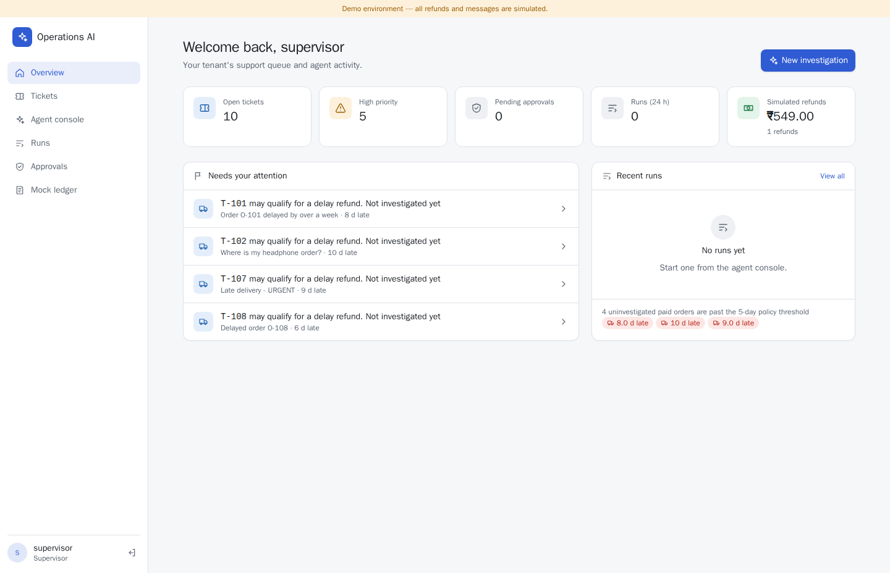
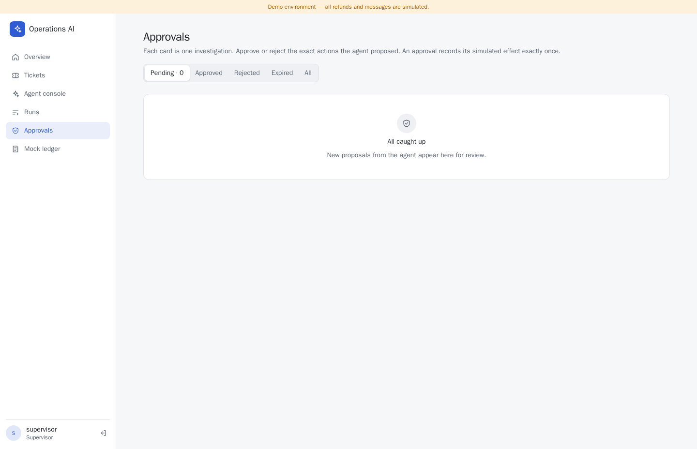
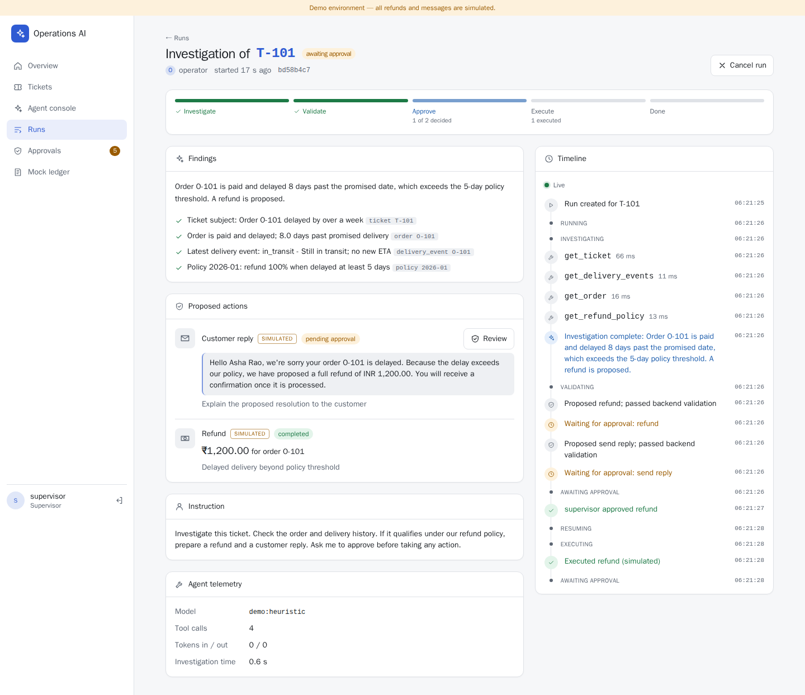

# Operations AI

A support-operations console where an AI agent investigates tickets, but **cannot act on its own**.
The agent reads data and proposes; deterministic backend rules validate; a supervisor approves; an
idempotent executor applies the change **exactly once**.

> **Everything is simulated.** A "refund" is a row in PostgreSQL and a "customer message" is a row in
> PostgreSQL. No bank, carrier or email provider is ever contacted.





## What it shows

| Area | How |
|---|---|
| AI agent | LangChain `create_agent` with read-only tools, structured output (`InvestigationResult`, discriminated union), tool/model call limits, bounded retries, prompt-injection resistance |
| MCP | Official MCP Python SDK v2 (`MCPServer`) over streamable HTTP. A per-run signed token scopes every call to one tenant. The agent loads tools through `langchain.mcp.MCPAdapter` |
| Durable workflow | LangGraph `StateGraph` with `interrupt()` / `Command(resume=…)` and a PostgreSQL checkpointer. Runs survive API and worker restarts while waiting for approval |
| Safety boundaries | Policy engine recomputes eligibility and the exact amount, so the LLM's numbers are never trusted. Each approval is bound to the action's SHA-256 fingerprint. Payloads are immutable (DB trigger). Unique constraints prevent double refunds. The audit log is append-only (DB trigger) |
| Backend | FastAPI + Pydantic v2, SQLAlchemy 2 + Alembic, PostgreSQL job queue with leases and `FOR UPDATE SKIP LOCKED`, SSE with `Last-Event-ID` replay via `LISTEN/NOTIFY` |
| Auth | Keycloak OIDC. The API verifies issuer, audience, signature and expiry; tenant and roles come only from the verified token |
| Frontend | Next.js 16 + Tailwind with a backend-for-frontend session (tokens never reach the browser). Pages: live timeline, approval cards, ledger and audit |
| Quality | 89 automated tests, a 37-scenario evaluation with measured results, a Playwright E2E test, and CI |



## Quick start

Requirements: Docker Desktop (or Docker Engine + Compose v2). Works on Apple Silicon; no GPU.

```bash
cp .env.example .env
docker compose up --build        # migrations, checkpointer setup and demo seed run automatically
```

| URL | What |
|---|---|
| http://localhost:3000 | Web console |
| http://localhost:8000/docs | OpenAPI docs |
| http://localhost:8080 | Keycloak (admin: `kcadmin` / `local-development-only`) |

If a port is taken, change `WEB_PORT`, `API_PORT`, `KEYCLOAK_PORT` or `POSTGRES_PORT` in `.env`.

### Demo accounts (local development only)

| User | Password | Role | Tenant |
|---|---|---|---|
| `operator` | `operator-demo` | operator: view, start investigations | Acme |
| `supervisor` | `supervisor-demo` | supervisor: + approve/reject | Acme |
| `admin` | `admin-demo` | admin: + audit trail | Acme |
| `globex-supervisor` | `globex-demo` | supervisor | Globex (used to show tenant isolation) |

### LLM configuration

By default `AGENT_MODEL=demo:heuristic`, a **deterministic, rule-based stand-in** for an LLM. It calls
the same MCP tools and returns the same structured output, so the full product works offline. The UI
shows which model ran each investigation. To use a real model:

```dotenv
AGENT_MODEL=openai:gpt-4.1-mini        # any LangChain "provider:model" with tool calling
OPENAI_API_KEY=sk-...
```

If the key is missing, investigations fail with a clear `llm_not_configured` error. Migrations,
seeding, tests and evaluations never need a key.

## Demo flow

See [docs/demo-script.md](docs/demo-script.md) for the 2–3 minute walkthrough. In short:

1. As `operator`, open **Agent console** and investigate `T-101`. Watch the tool calls stream in.
2. The run stops at **awaiting approval** with a proposed **₹1,200.00** refund and a customer reply.
   Nothing has happened yet.
3. As `supervisor`, open **Approvals** and approve the refund. The **Mock ledger** shows exactly one entry.
   Approving again does nothing.
4. Investigate `T-102` and reject it: no ledger entry.
5. As `admin`, open **Audit** to see who did what, when.

`make seed` resets the demo data.

## Commands

| Command | Does |
|---|---|
| `docker compose up --build` | Full stack |
| `make migrate` / `make seed` | Re-run migrations / reset fixtures in the stack |
| `make test` | Backend + MCP tests against a throwaway Postgres (Docker) |
| `make eval` | Runs `evaluations/scenarios.jsonl`, rewrites `docs/evaluation-report.md` |
| `make lint` / `make typecheck` | ruff / mypy |
| `make e2e` | Playwright E2E against the running stack (run `make seed` first) |
| `make token USER_NAME=supervisor PASS=supervisor-demo` | Dev access token for curl (password grant on the dev-only `operations-cli` client) |

Local Python development uses [uv](https://docs.astral.sh/uv/): `uv sync --all-packages`.

## Repository layout

```text
backend/            FastAPI app, LangGraph workflow, worker, domain services, Alembic, tests
  app/agent/        prompt, read-tool providers (direct + MCP), investigator, offline models
  app/services/     policy, proposals, approvals, executor, runs, job queue, audit, events
  app/workflow/     graph + checkpointer
  app/worker/       job runner + worker loop
mcp_servers/operations/   MCP server (official SDK v2), run-token auth, transport tests
frontend/           Next.js console, BFF auth/proxy routes, Playwright test
evaluations/        scenarios + runner
infra/              Keycloak realm, Postgres init
docs/               architecture, decisions, security, evaluation report, demo script
```

## Documentation

- [Architecture](docs/architecture.md): components and the approve / reject / restart sequences
- [Security](docs/security.md): threat model and trust boundaries
- [Decisions](docs/decisions.md): implementation choices and deviations from the spec
- [Evaluation report](docs/evaluation-report.md): measured results
- [API examples](docs/api-examples.http)
- [Specification](archi.md)

## Known limitations

- Single API replica: the run-creation rate limit is in-process.
- Keycloak runs in `start-dev` mode with an embedded database; the realm is re-imported on every start.
- The offline demo model is rule-based. Evaluation numbers for a real LLM need `--live-model` (paid).
- Simulated effects only. Real integrations would need a transactional outbox and provider-side idempotency.

## License

MIT. See [LICENSE](LICENSE). All customer data is fictional.
