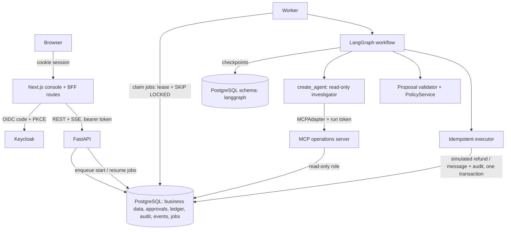
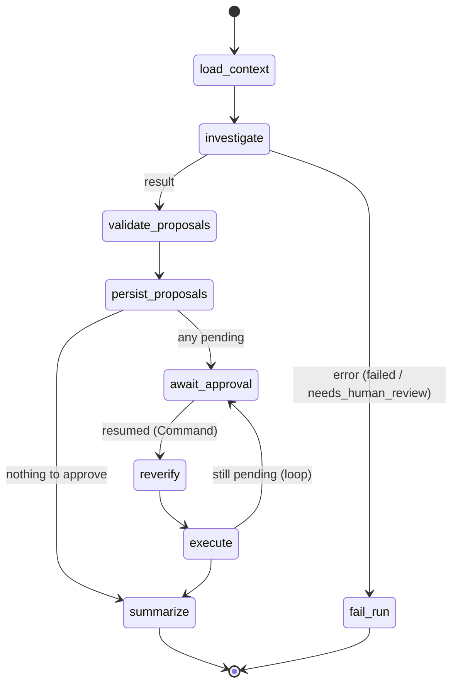

# Architecture

## Components



| Component | Owns | Never does |
|---|---|---|
| Frontend (`frontend/`) | Display; Keycloak login; same-origin proxy that attaches the token server-side | Decide eligibility; hold tokens in browser JS |
| API (`backend/app/api`) | Token verification, tenant scoping, run creation, approval decisions, SSE | Run the LLM |
| Worker (`backend/app/worker`) | Claiming jobs, running/resuming graphs, lease heartbeat, approval expiry | Accept work from the network |
| Workflow (`backend/app/workflow/graph.py`) | Explicit states, interrupt/resume, routing | Trust the resume payload |
| Investigator (`backend/app/agent`) | Tool calling, structured `InvestigationResult` | Write anything; see other tenants |
| MCP server (`mcp_servers/operations`) | Standard tool interface over the read services | Accept a tenant from the model |
| Policy + validator (`services/policy.py`, `services/proposals.py`) | Eligibility, exact amount, linkage checks | Use LLM opinions |
| Approval service (`services/approvals.py`) | Atomic pending → approved/rejected/expired; binding to the action hash | Accept action arguments from the request body |
| Executor (`services/executor.py`) | Re-verification under row locks, the effect, audit, all in one transaction | Run unapproved, expired, stale or modified actions |

## Workflow graph



Run statuses: `queued → running → investigating → validating → awaiting_approval → resuming → executing → completed`,
plus the terminal states `completed_no_action`, `rejected`, `failed`, `cancelled` and `needs_human_review`.

Each node is safe to re-run. `persist_proposals` returns existing rows if the run already has
actions. `await_approval` only sets a status before `interrupt()`. `execute` delegates to the
idempotent executor, one transaction per action. The inner agent is not a durable subgraph
(`checkpointer=False`). Re-running a read-only investigation after a crash is safe, and the parent
graph checkpoints its result.

## Sequence: approve

```mermaid
sequenceDiagram
    actor Op as Operator
    actor Sup as Supervisor
    participant API
    participant DB as PostgreSQL
    participant W as Worker
    participant MCP
    Op->>API: POST /runs {ticket T-101}
    API->>DB: insert run + job(start:run) + audit
    API-->>Op: 202 {run_id}
    W->>DB: claim job (lease)
    W->>MCP: get_ticket / get_order / ... (run token)
    MCP->>DB: tenant-scoped reads
    W->>DB: validate (PolicyService) → actions + approvals (pending)
    W->>DB: checkpoint at interrupt(); status awaiting_approval
    Sup->>API: POST /approvals/{id}/decision {approve}
    API->>DB: lock approval+action, check role/tenant/expiry/hash → approved, job(resume:run:approval)
    W->>DB: claim resume job
    W->>W: graph.invoke(Command(resume))
    W->>DB: executor: lock action+order, re-verify, insert refund, audit, commit
    W->>DB: summarize → completed
```

## Sequence: reject

The decision endpoint sets the approval and action to `rejected` and enqueues a resume job. On
resume, `execute` finds nothing approved, `summarize` sets the run to `rejected`, and no effect row is
ever written.

## Sequence: restart while waiting

```mermaid
sequenceDiagram
    participant W1 as Worker (old)
    participant DB as PostgreSQL
    participant W2 as Worker (new)
    W1->>DB: checkpoint at interrupt(); job done
    Note over W1: process killed / API restarted
    Note over DB: run, actions, approval and checkpoint are all durable
    DB-->>W2: resume job (after supervisor decision)
    W2->>DB: get_state(thread) → interrupted → invoke(Command(resume))
```

If a worker dies mid-job, its lease expires and another worker reclaims the job. A `start` job that
finds an existing checkpoint continues from it (`invoke(None)`) rather than starting over.

## Concurrency and exactly-once

- **Jobs:** `dedupe_key` is UNIQUE (`start:{run}`, `resume:{run}:{approval}`), so duplicate decisions
  never enqueue twice. Jobs for a run that already has a live lease are not claimed, which serialises
  work per run.
- **Effects:** `refunds.action_id`, `refunds.idempotency_key`, `UNIQUE (tenant_id, order_id)`,
  `outbound_messages.action_id` and `outbound_messages.idempotency_key` are all unique. The executor
  locks the action and order rows and returns the existing effect on replay.
- **Approvals:** `SELECT … FOR UPDATE` plus a state check. Only one transition out of `pending` succeeds.

## Events and SSE

Events are written to `agent_events` (bigint identity, a monotonic cursor) in the same transaction
as the change, followed by `pg_notify`. The SSE endpoint replays `id > Last-Event-ID` for the run (and
its children, for a batch), then `LISTEN`s, with a 2-second fallback check and 15-second heartbeats.
The browser uses native `EventSource` through the same-origin proxy, which authenticates with the
session cookie and handles reconnects.
